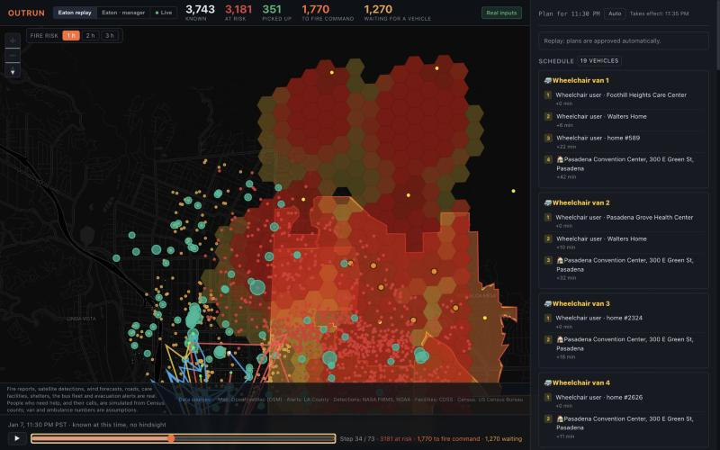
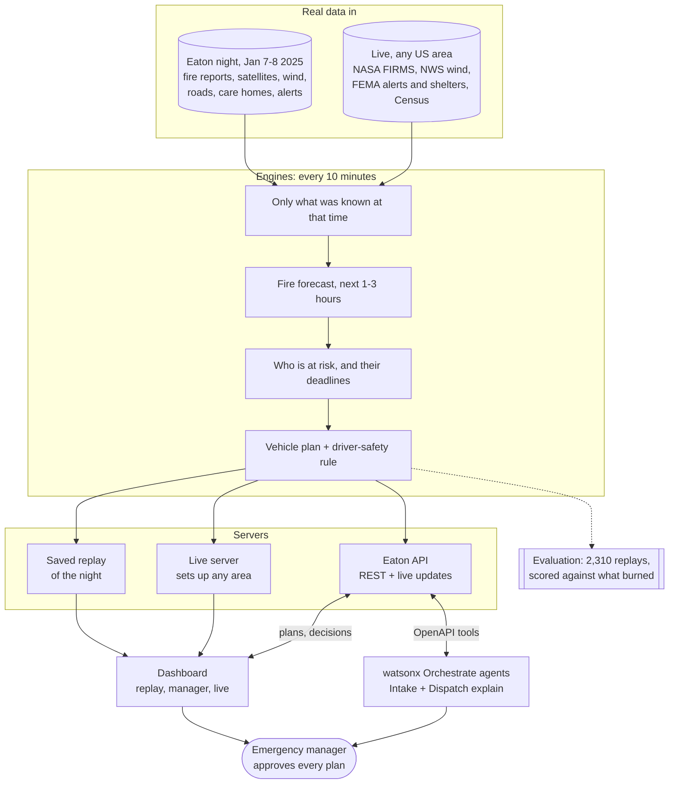

# Outrun

**Wildfire evacuation dispatch for the people who can't leave on their own.**

[](https://outrun-dashboard.onrender.com/?mode=replay)
[](https://github.com/alighazi288/Outrun/actions/workflows/ci.yml)




<sub>The Eaton Fire at 11:30 p.m., using only what was known at 11:30 p.m. Red hexes: where the
fire could be within the hour. Dots: people who need a ride. Right: each vehicle's next pickups.
The real evacuation order for west Altadena came at 3:25 a.m.</sub>

## Try it

| | |
|---|---|
| **[Eaton replay](https://outrun-dashboard.onrender.com/?mode=replay)** | The real night of Jan 7-8, 2025, step by step, with no hindsight. Opens instantly. |
| **[Manager mode](https://outrun-dashboard.onrender.com/?mode=manager)** | The same night, but nothing moves until you approve the plan. The free server takes about a minute to wake up. |
| **[Live](https://outrun-dashboard.onrender.com/?mode=live)** | Today's real US wildfires. Pick one, or any place, and Outrun sets the area up from national data in 10-20 seconds. |

## The problem

On Jan 7, 2025, the Eaton Fire started at 6:18 p.m. By 6:45 p.m. high winds had grounded every
aircraft, and responders lost their view from above. The evacuation order for west Altadena came
at 3:25 a.m., hours after the first fire reports west of Lake Avenue.

All 17 people who died were west of Lake Avenue, and many were elderly or disabled. Two homebound
disabled men died despite three 911 calls. Evacuation alerts assume people can leave. Nobody was
matching the people who needed a ride to the vehicles available and the time left.

## What Outrun does

1. **Sees where the fire can go.** Every 10 minutes it forecasts where the fire could reach in
   the next 1-3 hours, from fire reports, satellite detections and the wind forecast.
2. **Finds who can't leave alone.** Care-home residents, wheelchair users, people on home oxygen,
   bedbound people and people without a car.
3. **Plans the pickups.** Each person gets a deadline, the latest safe time to leave. Outrun
   decides which vehicle picks up whom, and re-plans every 10 minutes.
4. **Keeps drivers safe.** A vehicle is never sent anywhere the fire could reach before it gets
   back out.
5. **Drops nobody silently.** Anyone no vehicle can reach in time goes straight to fire command.
6. **Keeps a human in charge.** An emergency manager approves every plan. AI agents explain the
   plan in plain language; they never make up a number.

## Results

We replayed the Eaton night through Outrun using only what was known at each moment.

**Earlier warning.** West of Lake Avenue, 132 blocks burned. Outrun flagged every one of them:
the first at 8:40 p.m., half by 9:30 p.m. For the 119 of those blocks that got an evacuation
order, Outrun's flag came first every time, a median of about 6 hours earlier. It also flagged
blocks that didn't burn. It can say "west Altadena is in danger" hours early, but not yet which
streets.

**More people out in time.** The full evaluation replays the night 2,310 times: 30 simulated
populations, with every assumption changed one at a time
([full report](evaluation/results/REPORT.md)). The measure is the share of vulnerable people the
fire reached who were picked up before it could have arrived.

| Same 19 vehicles, same driver-safety rule | Picked up in time |
|---|---|
| **Outrun** | **5.4%** (4.7-6.5%) |
| Roughly how it works today: wait for the orders, then the nearest person | 4.5% |
| Outrun with a perfect fire forecast (hindsight, a ceiling) | 14.9% |
| Outrun with 80 vehicles and everyone on a pre-fire list | 30.5% |

- Outrun beats "roughly today" in **29 of 30** populations: about 24 more people out before the
  fire on that night.
- **No driver was ever sent into the fire** (0 vehicle-minutes, all 30 populations).
- The numbers are small because 19 vehicles can't reach 2,221 people at night. The real limits
  are fleet size and forecast accuracy, and Outrun shows a county both.
- Our planner ties a simple "most urgent first" rule that uses Outrun's forecast and deadlines.
  The value is in what Outrun knows and when, not in a cleverer route.

These are pickups before the fire under stated assumptions, not lives saved.

## How it works

**Agents explain, engines compute.** Every probability, deadline and route comes from a tested
Python engine. The AI agents read messy input, call those engines, and explain the results.



An approved plan goes back into the next 10-minute step: vehicles follow it, pick people up, and
the engines plan again from where everyone is.

| Part | Code |
|---|---|
| Real data in | `scripts/` builds the Eaton files into `data/processed/eaton/`; `backend/feeds.py` and `backend/area.py` pull live data for any US area |
| Only what was known | `backend/store.py` releases each source at its real publish delay; `backend/knowledge.py` decides who the planner knows about, and from when |
| Engines | `engines/nowcast.py` (fire forecast), `engines/risk.py` (risk and deadlines), `engines/routing.py` and `engines/travel.py` (vehicle plan, driver safety) |
| The 10-minute loop | `backend/replay.py` and `backend/sim.py`; a manager's approvals and edits in `backend/decisions.py` |
| Servers | `backend/api/main.py` (Eaton API), `backend/live.py` (live server), `backend/export.py` (saved replay); hosted on Render (`render.yaml`) |
| Dashboard | `dashboard/` (React, MapLibre, deck.gl) |
| Agents | `agents/` (ADK YAML and the `tools.openapi.json` they call) |
| Evaluation | `evaluation/` (scoring, the dispatcher rule, the full evaluation and its report) |
| Checks | `tests/`: no hindsight, driver safety, nobody dropped, every dataset meets the contract |
| Docs | [product spec](docs/PRD.md), [architecture](docs/ARCHITECTURE.md), [evaluation spec](docs/EVAL_SPEC.md), [team](docs/TEAM.md) |

## Built with IBM

- **IBM Bob** was our development partner. It built the NOAA wind-forecast pipeline and its
  tests, planned and built the dashboard, and drafted the agent definitions and the plans for the
  routing, evaluation, fire-report and satellite work. Screenshots of every session are in
  [`bob_sessions/`](bob_sessions/).
- **watsonx Orchestrate** runs two agents, defined as ADK YAML in [`agents/`](agents/):
  - **Intake** turns messy text ("my dad's on oxygen, 2nd floor") into checked records.
  - **Dispatch** explains the plan to the manager and records their decision. It never approves
    on its own.

  They call our API through [`agents/tools.openapi.json`](agents/tools.openapi.json).

## Real data, checked

| Real public data | Simulated |
|---|---|
| Fire reports, satellite detections (NASA FIRMS, NOAA GOES-18), wind forecasts (NOAA HRRR, NWS), roads (OpenStreetMap), care homes (CDSS), shelters, the bus fleet, evacuation alerts (LA County), which buildings burned (CAL FIRE) | The people who need a ride and their calls, estimated from Census counts, because real addresses and 911 records aren't public |

How we keep it honest:

- **No hindsight.** Each source only counts from the moment it was published on the night, with
  its real delay. Tests check this.
- **No hidden guesses.** Every assumed number (loading times, van counts, the safety margin)
  lives in [`backend/assumptions.py`](backend/assumptions.py), labeled, and the evaluation tests
  each one over a range.
- **No tuning on the answer.** Forecast settings were chosen on a second fire (Palisades) and
  tested on Eaton once.
- **Labels on screen.** The dashboard marks what's real and what's estimated, and `make check-data`
  checks a dataset against the data contract.
- Every source is listed with its license in [`DATA_SOURCES.md`](DATA_SOURCES.md).

## Limits

- The fire forecast is a simple wind-driven spread model. It warns early but too broadly. An
  ember model was tried and failed its test on Eaton, so it isn't used.
- The people are simulated from Census counts. A county would load its own list.
- The evaluation covers one fire night. Live areas use straight-line road times until a road file
  is built.

## Run it yourself

Requires [uv](https://docs.astral.sh/uv/) (it installs the right Python) and `make`.

```bash
git clone https://github.com/alighazi288/Outrun.git && cd Outrun
make install                      # Python dependencies
make check                        # lint + all tests (what CI runs)
OUTRUN_DATASET=eaton make view    # the Eaton replay in the dashboard at http://localhost:5173
make api                          # the Eaton API at http://localhost:8000 (docs at /docs)
make live                         # the live server at http://localhost:8001
make help                         # everything else
```

Live mode needs a free `FIRMS_MAP_KEY` and `CENSUS_API_KEY` in `.env`. To rerun the evaluation:
`make sweep` (about 6 hours on one laptop, resumable), then `make report`.

## Team

Bhavaani (product and evaluation), Ali (backend, agents, dashboard, and routing),
Daniel (fire forecast). Built for the IBM SkillsBuild AI Experiential Learning Lab, Government &
Public Services track.

Data sources and attribution: [`DATA_SOURCES.md`](DATA_SOURCES.md). Map data © OpenStreetMap
contributors (ODbL).
